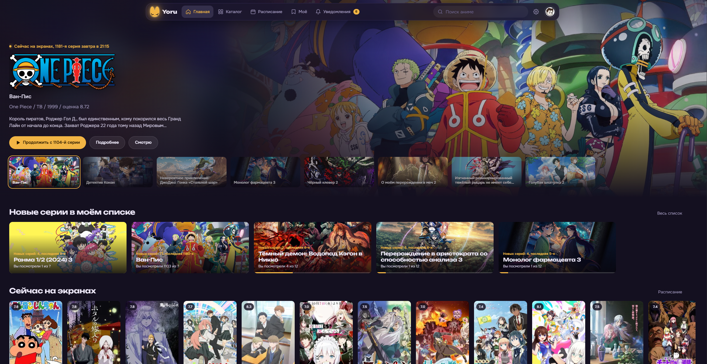
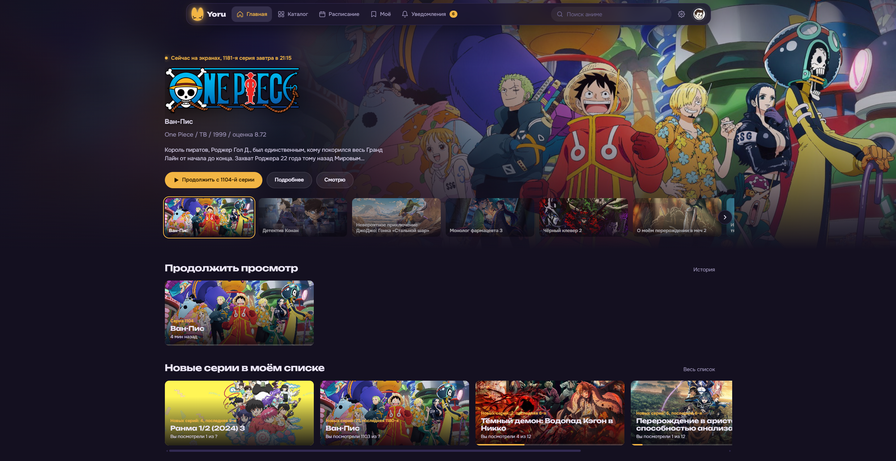
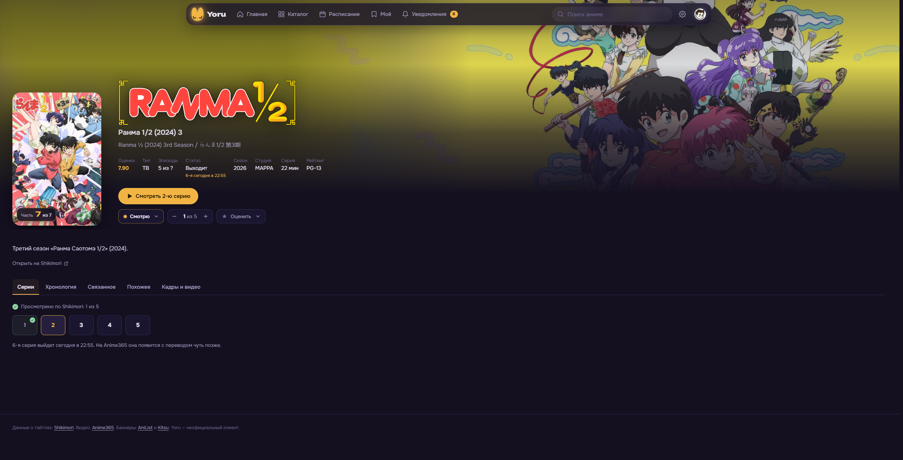
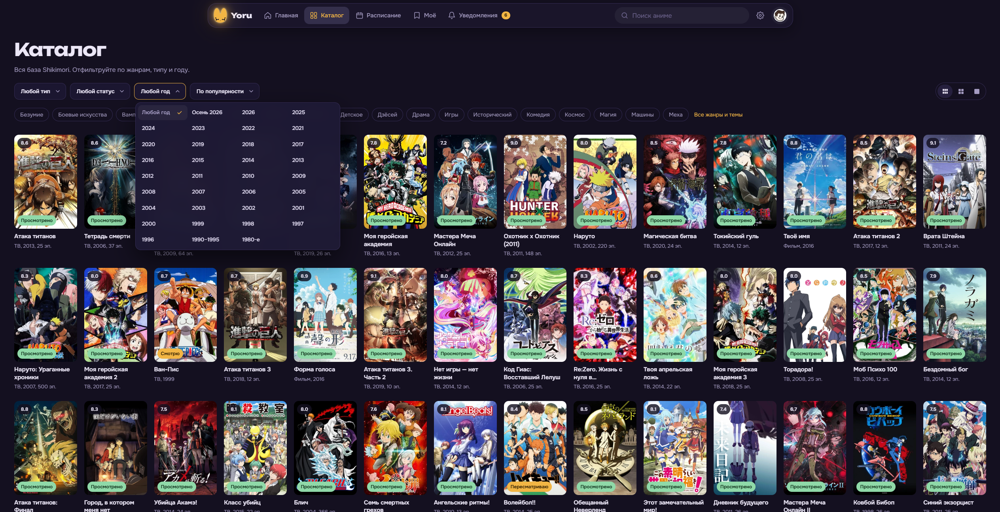
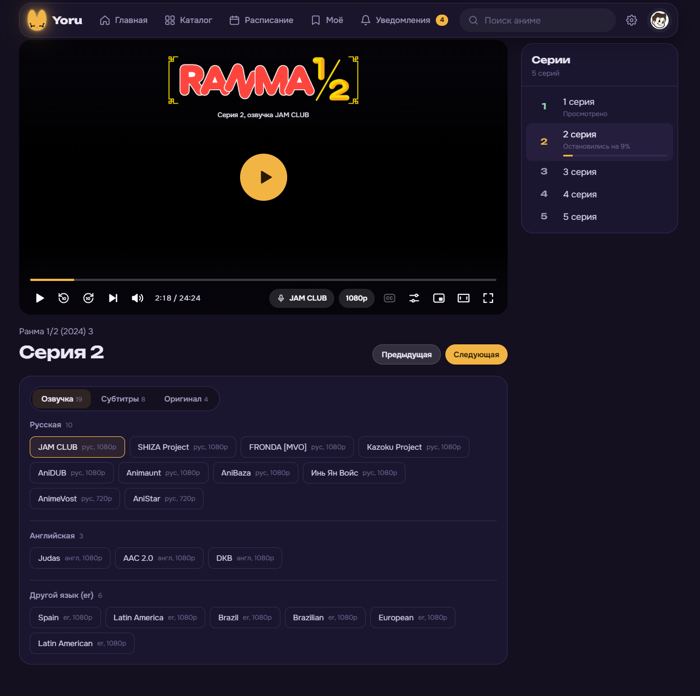
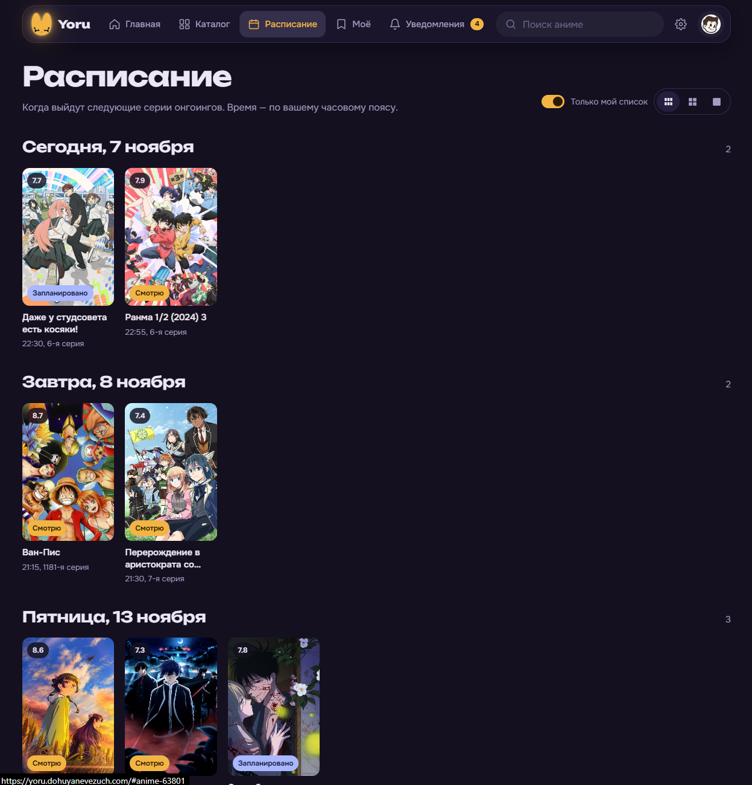
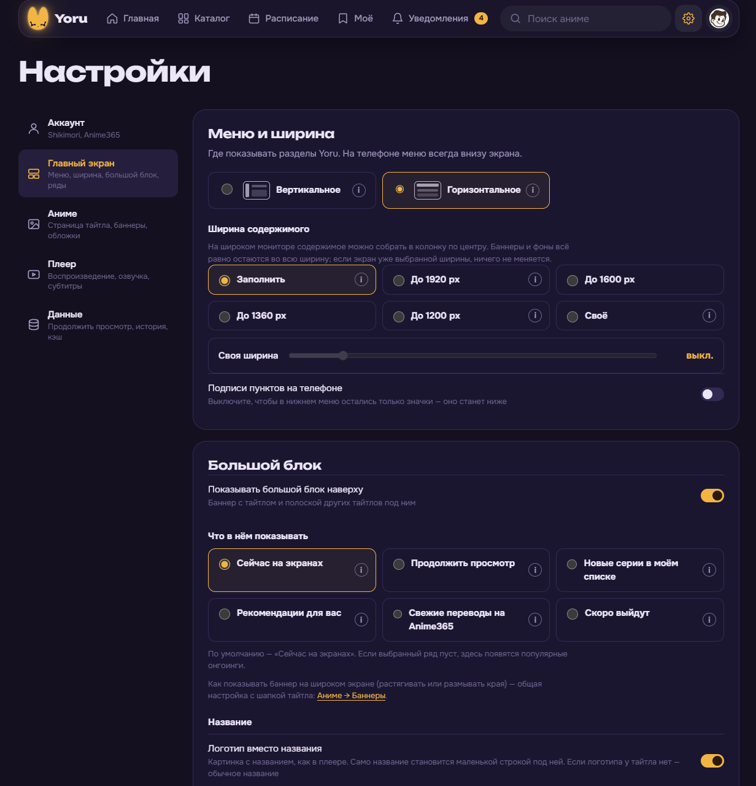
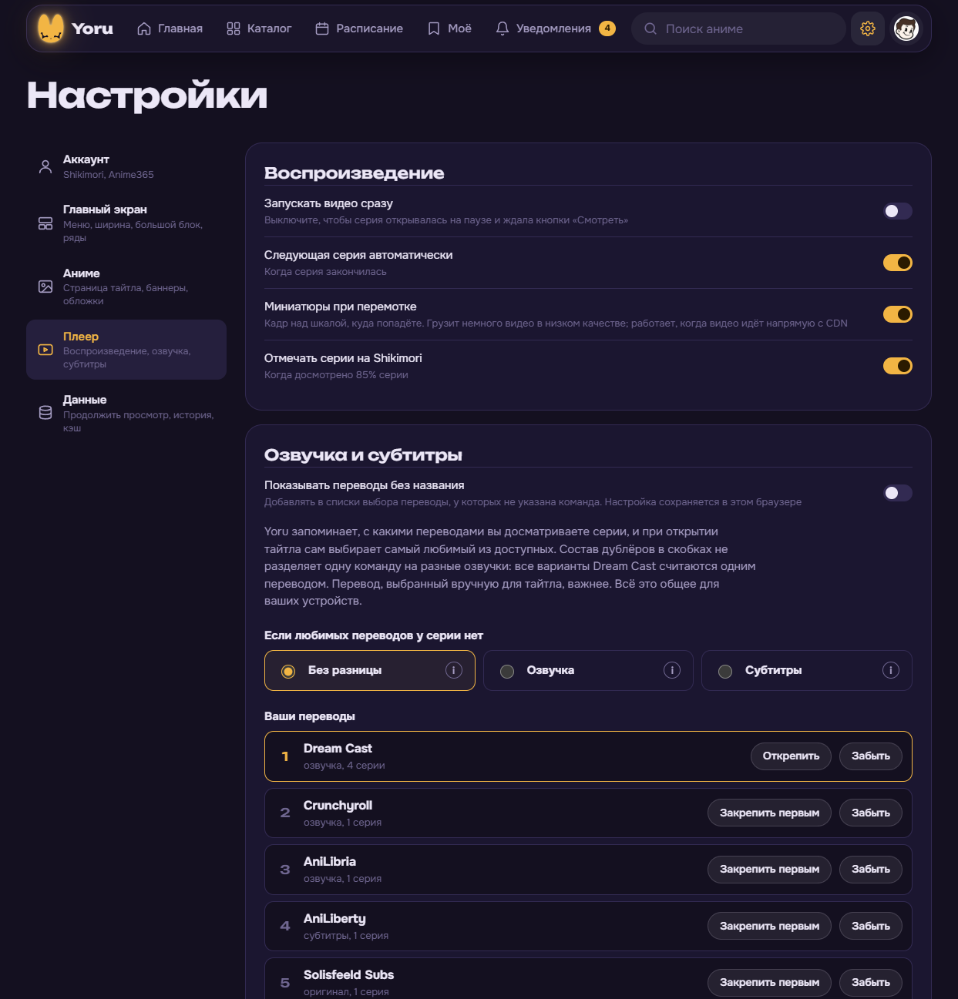

# Yoru


Yoru — веб-приложение для поиска и просмотра аниме, которое объединяет каталог и личный список Shikimori с видео Anime365. Вы можете развернуть собственный экземпляр, войти через Shikimori и пользоваться им в браузере на компьютере или телефоне.

Приложение помогает найти тайтл, выбрать озвучку, продолжить начатую серию и отметить просмотренное в своём списке. Сервер хранит историю и позиции просмотра, поэтому к ним можно вернуться с другого устройства, войдя в тот же экземпляр Yoru.

<details>
  <summary>Снимки экрана /screenshots</summary>

|  |  |
| --- | --- |
| Главный экран по умолчанию | С ограничением ширины контейнера |
|  |  |
| Страница тайтла | Каталог |
|  |  |
| Плеер | Расписание |
|  |  |
| Настройки главного экрана | Настройки плеера |
|  |  |

</details>

## Возможности

- Каталог с поиском, жанрами, фильтрами и сортировкой.
- Страницы тайтлов с описанием, сериями, хронологией франшизы, связанными и похожими аниме.
- Личный список Shikimori, оценки, статусы и отметки просмотренных серий.
- Дашборд профиля со статистикой списка и распределением оценок.
- Настраиваемая главная страница с большим баннером, рекомендациями и рядами тайтлов. Ряды можно скрывать и менять местами.
- Собственный видеоплеер с выбором перевода, языка, качества, субтитров и канала доставки видео.
- Компактный, широкий и полноэкранный режимы просмотра, а также картинка в картинке при поддержке браузером.
- Продолжение просмотра, автоматический переход к следующей серии и отметка просмотренного на Shikimori.
- Предпочтения озвучек с закреплением любимой команды. Меняющийся состав голосов в скобках объединяется под названием команды.
- Уведомления по списку аниме.
- Отдельная панель администратора для управления доступом, интеграциями и использованием видеопрокси.

## Как это работает

| Источник | Для чего используется |
| --- | --- |
| Shikimori | Каталог, информация о тайтлах, личный список, оценки, статусы и данные профиля |
| Anime365 | Доступные серии, переводы и видеопотоки |
| AniList и Kitsu | Дополнительные баннеры и обложки |
| TMDB | Баннеры и логотипы тайтлов, если администратор указал ключ |

Браузер загружает интерфейс Yoru и обращается к его серверу. Сервер выполняет OAuth-вход, работает с внешними API и хранит пользовательские данные.

Для сопоставления тайтлов Shikimori и Anime365 используются идентификаторы MyAnimeList. Если у Anime365 нет подходящего тайтла или перевода, просмотр через эту интеграцию будет недоступен.

Способ загрузки видео задаёт администратор. Видео может идти напрямую с CDN Anime365, через сервер Yoru или с запасным переходом на сервер при ошибке прямого соединения. Проксирование видео расходует трафик сервера, поэтому в панели предусмотрены ограничения.

Yoru — неофициальный клиент перечисленных сервисов. Доступность данных, видео и отдельных функций зависит от их API, вашего аккаунта и возможностей браузера. Для просмотра через Anime365 нужен действующий токен и доступ к видео в этом сервисе, включая подписку, когда она требуется.

## Что нужно для запуска

- Node.js **22.12 или новее** и npm, либо Docker с Docker Compose.
- Доступ сервера к внешним API.
- Зарегистрированное OAuth-приложение Shikimori.
- Аккаунт Anime365 с токеном для просмотра видео.
- Ключ TMDB, если нужны баннеры и логотипы из этого источника.

## Локальный запуск

Склонируйте репозиторий и установите зависимости.

```powershell
git clone https://github.com/Yoru-app/yoru-web.git
cd yoru-web
npm install
```

Создайте файл окружения из примера.

```powershell
Copy-Item .env.example .env
```

Для локального запуска укажите в `.env` адрес приложения.

```dotenv
PUBLIC_URL=http://127.0.0.1:5366
```

Соберите интерфейс и запустите сервер.

```powershell
npm run build
node --env-file=.env server.js
```

Приложение откроется по адресу [http://127.0.0.1:5366](http://127.0.0.1:5366), панель администратора — по адресу [http://127.0.0.1:5366/admin_panel](http://127.0.0.1:5366/admin_panel).

После изменения клиентского кода повторите `npm run build`. Команда `npm start` запускает только сервер и использует переменные текущего окружения. Для чтения `.env` используйте показанную выше команду с `--env-file`.

## Первая настройка

1. Откройте `/admin_panel`. Если логин администратора ещё не задан, используйте код первого запуска из журнала сервера и создайте учётную запись.
2. Зарегистрируйте приложение в [Shikimori](https://shikimori.io/oauth/applications) с правом `user_rates`. Для локального экземпляра укажите адрес возврата `http://127.0.0.1:5366/oauth/shikimori`.
3. В панели Yoru сохраните Client ID и Client Secret приложения. Их также можно задать переменными окружения.
4. Настройте доступ пользователей. Добавьте свой ник Shikimori в список доступа либо разрешите вход любому аккаунту.
5. Откройте главную страницу и войдите через Shikimori.
6. В разделе «Настройки → Аккаунт → Anime365» добавьте свой токен Anime365.
7. При необходимости добавьте ключ TMDB в панели администратора.

Адрес возврата должен точно соответствовать `PUBLIC_URL/oauth/shikimori`. При переходе с локального адреса на домен обновите и `PUBLIC_URL`, и настройки OAuth-приложения.

## Запуск через Docker

Создайте `.env` из `.env.example`, укажите `PUBLIC_URL` и выполните команды в папке проекта.

```sh
docker compose up -d --build
docker compose logs -f yoru-web-v3
```

По умолчанию Compose открывает порт `5366` на локальном интерфейсе хоста. Пользовательские данные сохраняются в `./data` через подключённый том.

Для доступа из интернета настройте домен и HTTPS через обратный прокси. Примеры Caddy и systemd находятся в `deploy/`.

## Переменные окружения

| Переменная | Назначение |
| --- | --- |
| `PUBLIC_URL` | Внешний адрес приложения без завершающего слеша |
| `HOST`, `PORT` | Интерфейс и порт Node.js-сервера. По умолчанию `127.0.0.1:5366` |
| `YORU_BIND` | Адрес публикации порта Docker Compose |
| `DATA_DIR` | Папка данных. По умолчанию `data` рядом с сервером |
| `YORU_ADMIN_LOGIN`, `YORU_ADMIN_PASSWORD` | Логин и пароль администратора, если хотите задать их через окружение |
| `SHIKIMORI_CLIENT_ID`, `SHIKIMORI_CLIENT_SECRET` | Данные OAuth-приложения Shikimori |
| `SHIKIMORI_APP_NAME` | Название приложения, передаваемое Shikimori |
| `TMDB_API_KEY` | Ключ TMDB для баннеров и логотипов |
| `ANIME365_SITE` | Адрес используемого сервера Anime365 |

Пример конфигурации находится в [`.env.example`](.env.example). Данные, заданные переменными окружения, имеют приоритет над соответствующими настройками в панели администратора.

## Хранение данных

Сервер использует JSON-файлы в `data/`. Там находятся учётные записи, токены, сессии, правила доступа, история, позиции просмотра, предпочтения переводов и кэш иллюстраций. Отдельная СУБД для запуска не требуется.

История, позиции и предпочтения переводов доступны на устройствах, подключённых к одному серверу под одним аккаунтом. Внешний вид и большинство настроек интерфейса сохраняются в браузере отдельно для пользователя.

**Не публикуйте `data/` и `.env`.** Они могут содержать OAuth-секреты, токены пользователей и данные сессий. Эти пути, а также `node_modules/` и `dist/`, исключены через `.gitignore`.

## Устройство проекта

| Путь | Содержимое |
| --- | --- |
| `src/` | Vue-компоненты, страницы, навигация и анимации |
| `public/js/` | Интеграции с API, видеодвижок и вспомогательные блоки интерфейса |
| `public/app.css` | Общие стили приложения |
| `public/brand/` | Изображения и брендовые материалы |
| `server.js` | HTTP-сервер, OAuth, API, хранение данных и административные маршруты |
| `deploy/` | Примеры конфигурации для развёртывания |
| `dist/` | Собранный интерфейс, создаваемый командой `npm run build` |

Клиент построен на Vue 3 с Composition API и Vite. Сервер работает на Node.js. Часть внутренних блоков интерфейса использует HTML-шаблоны вместе с Vue-компонентами.
